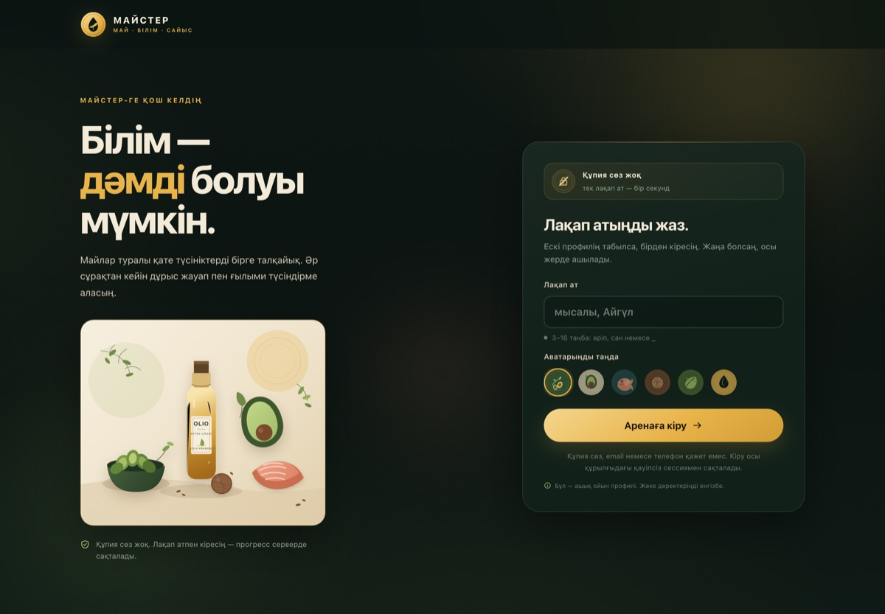
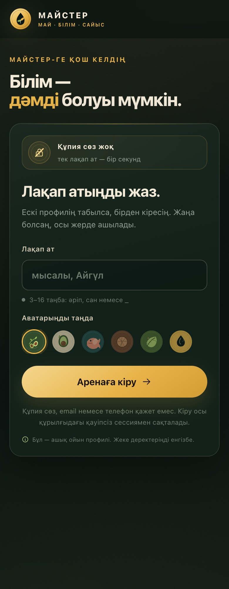
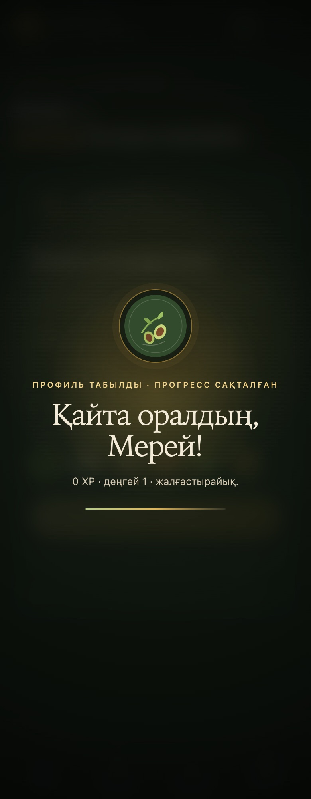

# МАЙСТЕР

Майлар мен тағамтану туралы қазақша білім сайысы. Жоба «Майлар және олардың тағамтанудағы маңызы» дәрісінің материалына негізделген 48 сұрақтан тұрады.



## Мүмкіндіктер

- **Құпия сөзсіз кіру** — тек лақап ат. Бар профиль автоматты танылады, жаңа профиль сол жерде ашылады.
- **Үш режим** — жеке жаттығу (20 сұрақ × 30 сек), күнделікті сынақ (8 сұрақ × 20 сек) және 1v1 дүэл (8 сұрақ × 15 сек).
- **Нақты уақыттағы 1v1** — жылдам матч немесе 6 таңбалы бөлме коды; SSE арқылы сұрақтар, жауаптар және нәтиже синхрондалады.
- **Прогресс** — XP, деңгейлер, 10 марапат, 7 күндік серия, дәлдік және жеке рекорд.
- **Рейтинг** — жалпы XP, бүгінгі нәтиже және жеке рекорд бойынша.
- **Мобильді интерфейс** — 390 px экраннан бастап 1440 px десктопқа дейін.
- **Анимациялар** — лақап атты тексеру, аватар, welcome-экран, ұпай қозғалысы, дұрыс/қате жауап әсерлері, конфетти және параллакс.




## Іске қосу

Node.js **22.5+** керек.

```bash
npm start
# http://localhost:3000
```

Сол Wi‑Fi желісіндегі телефоннан терминалда көрсетілген `http://<жергілікті-IP>:3000` мекенжайымен кіруге болады.

## Аккаунт моделі және қауіпсіздік

Бұл — ашық, казуал ойын профилі. **Құпия сөз жоқ**: кіру үшін лақап ат жетеді. Сондықтан:

- лақап атты білген адам сол профильге кіре алады;
- жеке, қаржылық немесе медициналық құпия деректерді бұл профильде сақтамаңыз;
- сессия HttpOnly cookie арқылы беріледі және серверде хэштелген күйде сақталады.

Егер толық қорғалған аккаунт керек болса, email/пароль немесе OAuth провайдерін қосу керек. Бұл нұсқа әдейі «бір лақап ат — бір секунд» принципімен жасалған.

## Деректер

- SQLite дерекқоры: `data/maister.db` (git-ке кірмейді).
- Сұрақ банкі: `data/questions.js`.
- Сервер: `server.js`; статикалық клиент: `public/`.
- Сервер бірінші іске қосылғанда кестелерді өзі жасайды.

## Деплой

Бұл жоба тек статикалық сайт емес: аккаунт, SSE және SQLite үшін тұрақты жұмыс істейтін Node сервері керек. GitHub Pages жарамайды. Node 22.5+ қолдайтын хостингке (мысалы, Render, Railway, Fly.io немесе VPS) орналастырып, `data/` үшін тұрақты диск қосыңыз. Әйтпесе сервер қайта іске қосылғанда дерекқор жоғалуы мүмкін.

## Дереккөз

Сұрақтар «Майлар және олардың тағамтанудағы маңызы» дәрісінің 22 слайды негізінде құрастырылған. Сайт білім сайысы болып табылады және медициналық кеңес бермейді.
